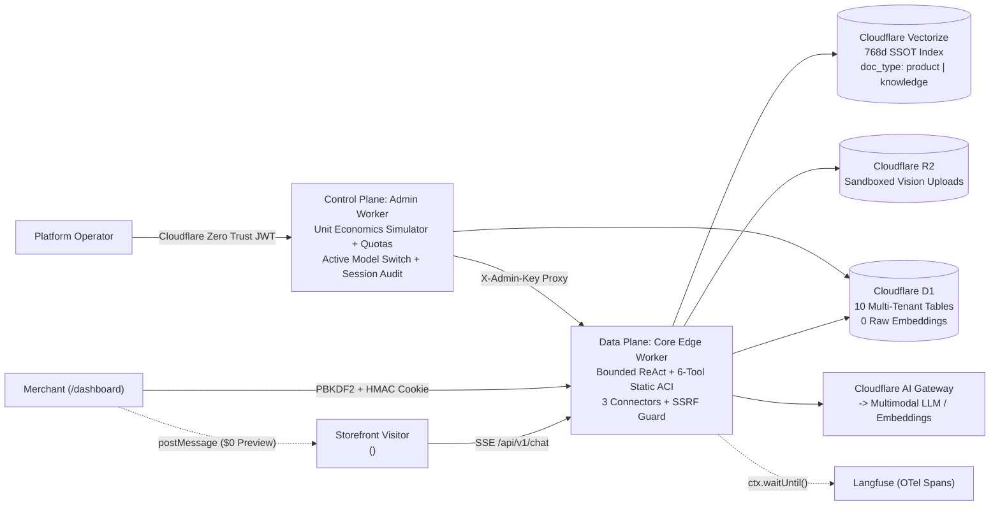
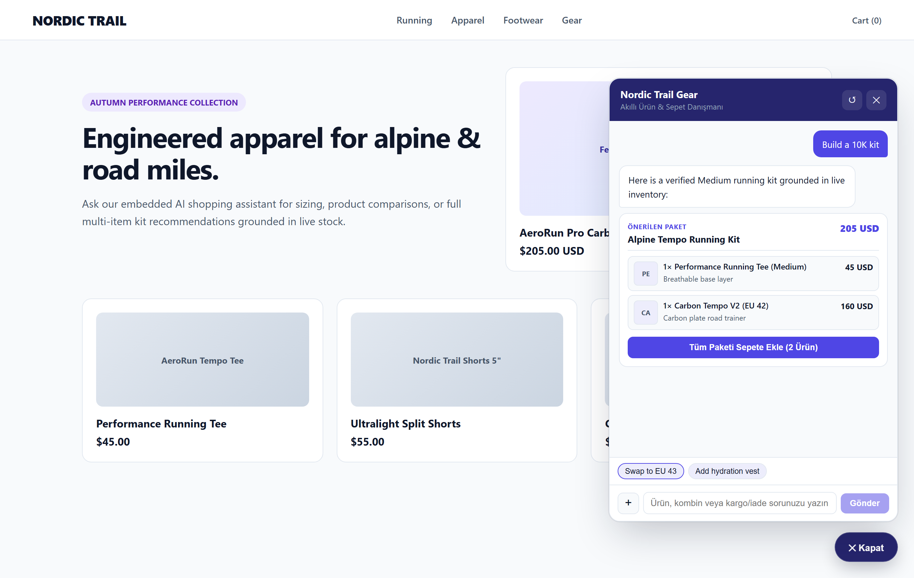
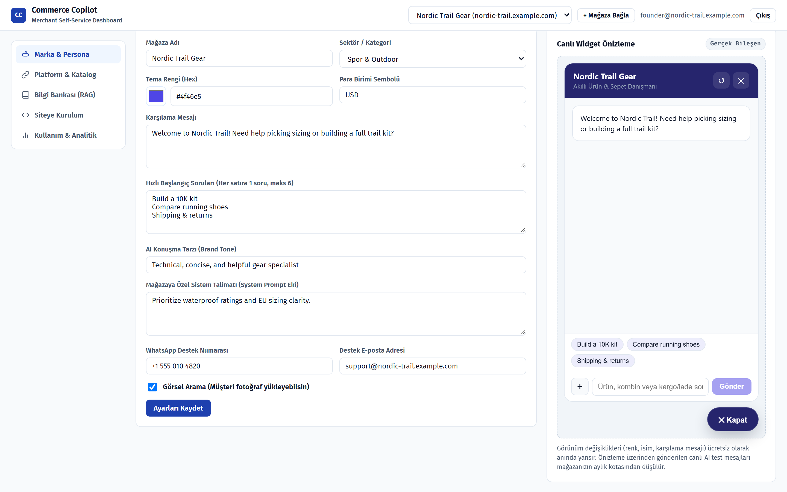
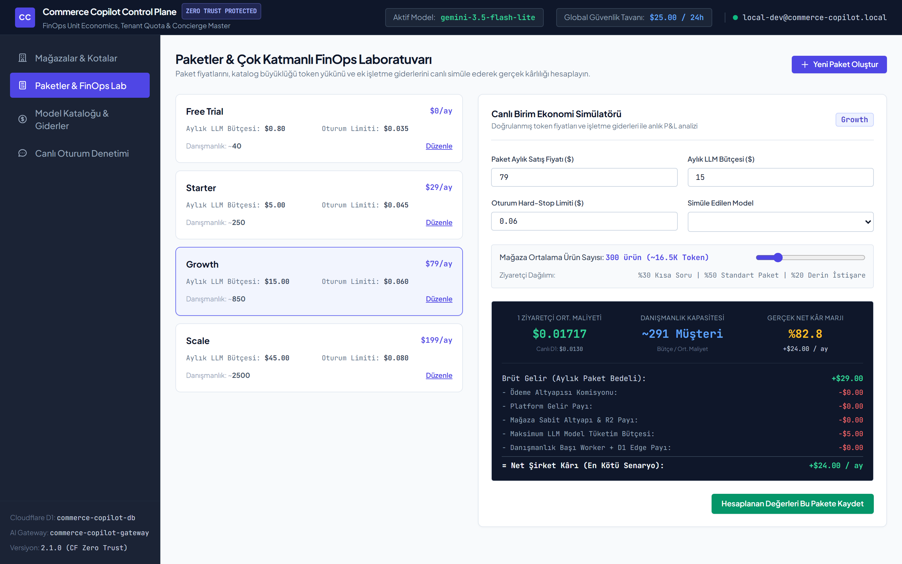

# Commerce Copilot — Multi-Tenant Edge AI SaaS & Agentic Architecture

[](https://github.com/cewjh/commerce-copilot-architecture/actions/workflows/ci.yml)
[](docs/00-c4-architecture-and-data-model.md)
[](docs/01-agentic-architecture.md)
[](docs/02-agentic-rag-and-retrieval.md)
[](EVALS.md)
[](SECURITY.md)

> **Repository Scope:** This repository is the public **C4 system architecture, ADR catalog, evaluation blueprint, and zero-dependency sanitized reference implementation** for **Commerce Copilot** (and its domain-vertical origin, **AquaBot**). Proprietary system prompts, domain physics coefficients, tenant catalogs, and live deployment identifiers are maintained privately.

**Commerce Copilot** is a multi-tenant, domain-agnostic **Edge AI Shopping Assistant & SaaS FinOps Platform** running natively on **Cloudflare V8 Workers**. It spans three decoupled architectural planes—a **Data Plane** (Bounded Native ReAct + Dual-Doc Vectorize RAG + Universal Catalog Connectors + `~15 KB` Shadow DOM Widget), a **Tenant Self-Service Plane** (`/dashboard` with Web Crypto auth, Wappalyzer-style auto-discovery & `$0` live widget preview), and a **Zero Trust Control Plane** (`cloudflare-admin` with FinOps unit economics simulation & model governance).

---

## System Topology at a Glance (3-Plane SaaS Architecture)



---

## Visual Product Surfaces (Sanitized Local Demo Renders)

| Storefront Widget (Shadow DOM + Verified Bundle) | Merchant Portal (`/dashboard` + `$0` Live Preview) |
| :---: | :---: |
|  |  |

| Zero Trust FinOps Control Plane (Unit Economics Simulator & Plan Governance) |
| :---: |
|  |

---

## Key Engineering Highlights

* **Framework-Less Bounded Native ReAct Loop (`0ms` Cold Start):** Runs a provider-agnostic orchestration loop over a static **6-tool Read/Write ACI** (`parametersJsonSchema`, `additionalProperties: false`, leading `intent` Thought Slots) preserving **KV-cache prefix invariance** in native `AUTO` mode. Read tools run concurrently via `Promise.all`; write mutations run serially with `(tool, args)` loop detection, `maxSteps`/budget ceilings, and tool-free graceful wrap-up ([01-agentic-architecture.md](docs/01-agentic-architecture.md)).
* **Fail-Loud Self-Correcting Cart Engine:** Never silently downgrades invalid `variant_id` arguments to `variants[0]`. Rejects mismatches with `invalid_variant_id` + `available_variants[]` for same-turn LLM self-correction and executes atomic `replace` swaps ([cart_mutation.mjs](references/src/cart/cart_mutation.mjs)).
* **Dual-Doc Vectorize SSOT + SQL Vector Bypass:** Stores both `product` and `knowledge` 768d embeddings in a single Vectorize index (keeping only 16-char hashes in D1—cutting D1 catalog footprint by `~88%`). Explicit price-sorted/wildcard queries bypass embeddings (`embedCallCount == 0`), while `1 -> 0` stock drops purge vectors in `20`-ID batches ([02-agentic-rag-and-retrieval.md](docs/02-agentic-rag-and-retrieval.md)).
* **Three Universal Connectors & SSRF Boundary:** Normalizes Shopify Native (OAuth + fail-closed HMAC webhooks + `/policies.json` RAG), Google/Meta XML Feeds (`<g:item_group_id>` variant grouping), and scoped REST Push (`X-Merchant-Ingest-Key`), guarded by strict HTTPS-only/IPv4/IPv6/redirect SSRF validation ([ssrf.mjs](references/src/core/ssrf.mjs), [03-universal-connectors-and-ssrf.md](docs/03-universal-connectors-and-ssrf.md)).
* **Zero-Dependency Web Crypto Merchant Portal & Auto-Discovery:** Implements Edge-native `PBKDF2-SHA256` (`100k` iterations), HMAC session cookies, single-use hashed `claim_token` store handovers, Wappalyzer-style storefront fingerprinting (`Shopify`, `WooCommerce`, `ikas`, `Ticimax`, `T-Soft`), and same-origin `postMessage` live widget previews ([05-merchant-portal-and-onboarding.md](docs/05-merchant-portal-and-onboarding.md)).
* **Zero Trust FinOps Control Plane:** Verifies Cloudflare Access JWTs (`RSASSA-PKCS1-v1_5` via cached JWKS), switches active LLMs dynamically, simulates per-tier gross margins against real SQL session cost telemetry, and audits/unfinalizes sessions ([04-control-plane-and-finops.md](docs/04-control-plane-and-finops.md)).
* **Domain-Calibrated Vertical Proof (AquaBot Case Study):** Demonstrates how the same engine powers deterministic aquascaping physics/engineering specs, R2 multimodal tank vision, and a 32-scenario vertical DeepEval benchmark ([06-aquabot-vertical-case-study.md](docs/06-aquabot-vertical-case-study.md)).

---

## Runnable Reference Code & Unit Tests (`references/`)

To demonstrate real code structure and verification standards without exposing proprietary IP, [`references/`](references/) contains **zero-dependency, Web-Standards ESM reference modules** (SSRF guard, Web Crypto PBKDF2/HMAC/Zero Trust JWKS, Bounded ReAct loop, loop detector, fail-loud cart mutations, sliding-tail `<quick_replies>` SSE parser, and platform fingerprinter) backed by automated `node --test` suites:

```bash
cd references
npm test
```

---

## Architecture Documentation & Decision Records (ADRs)

| Document | Focus Area |
| :--- | :--- |
| [00 — C4 Architecture & Data Model](docs/00-c4-architecture-and-data-model.md) | C4 Context/Container/Component diagrams, 3-plane SaaS topology, 10-table D1 ERD |
| [01 — Agentic Architecture & Streaming](docs/01-agentic-architecture.md) | Bounded ReAct loop, static 6-tool ACI, KV-cache stability, fail-loud self-correction, sliding-tail SSE |
| [02 — Agentic RAG & Dual-Doc Retrieval](docs/02-agentic-rag-and-retrieval.md) | Single-index `product \| knowledge` contract, `search_terms[]` RRF, SQL Vector Bypass, batch purge |
| [03 — Universal Connectors & SSRF Guard](docs/03-universal-connectors-and-ssrf.md) | Shopify OAuth/HMAC, Google/Meta XML feeds, REST Push, Wappalyzer discovery, SSRF defense |
| [04 — Zero Trust Control Plane & FinOps](docs/04-control-plane-and-finops.md) | Zero Trust JWKS gate, dynamic model switching, unit economics simulator, Core Worker proxy |
| [05 — Merchant Portal & Shadow DOM Widget](docs/05-merchant-portal-and-onboarding.md) | Edge PBKDF2/HMAC auth, `claim_token` flows, `postMessage` live preview, storefront `CartAdapter` |
| [06 — Vertical Case Study: AquaBot](docs/06-aquabot-vertical-case-study.md) | Deterministic aquascaping engineering specs, R2 vision analysis, 32-scenario vertical DeepEval |
| [EVALS.md](EVALS.md) | 3-Layer AI Testing Pyramid, Chromium Shadow DOM E2E, DeepEval/G-Eval, cross-process rate queue |
| [SECURITY.md](SECURITY.md) | Multi-tenant isolation, cryptographic primitives, SSRF boundaries, R2 sandbox CSP |

<details>
<summary><strong>Architecture Decision Records (ADR-001 through ADR-010)</strong></summary>

| ADR | Decision |
| :--- | :--- |
| [ADR-001](docs/adr/ADR-001-fastapi-to-cloudflare-edge.md) | Edge Runtime Architecture on Cloudflare V8 Workers |
| [ADR-002](docs/adr/ADR-002-frameworkless-native-react-agent.md) | Framework-less Native ReAct Agent Loop Instead of Agent Frameworks |
| [ADR-003](docs/adr/ADR-003-shadow-dom-preact-widget.md) | Preact + Shadow DOM Embeddable Widget Over Iframe Isolation |
| [ADR-004](docs/adr/ADR-004-three-layer-agent-testing-pyramid.md) | Three-Layer AI Agent Testing Pyramid |
| [ADR-005](docs/adr/ADR-005-hybrid-agentic-rag-with-sql-bypass.md) | Hybrid Agentic RAG with Deterministic SQL Vector Bypass |
| [ADR-006](docs/adr/ADR-006-single-brain-parallel-react-loop.md) | Single-Brain Parallel ReAct Loop & Zero-Cost Streaming Synthesis |
| [ADR-007](docs/adr/ADR-007-vectorize-single-source-of-truth.md) | Vectorize Single Source of Truth & Strict Tenant Isolation |
| [ADR-008](docs/adr/ADR-008-universal-connectors-and-ssrf-boundary.md) | Universal Catalog Connectors, Auto-Discovery & SSRF Boundary |
| [ADR-009](docs/adr/ADR-009-edge-native-webcrypto-merchant-auth.md) | Edge-Native Web Crypto Merchant Auth & Decoupled Store Claim Flow |
| [ADR-010](docs/adr/ADR-010-dual-doc-single-vectorize-index.md) | Dual-Document Single Vectorize Index Over Separate Vector Indexes |

</details>

---

## Architectural Trade-offs & Known Boundaries

* **SQLite / D1 Write Serialization:** Cloudflare D1 excels at `<2ms` edge reads, while high-concurrency global writes serialize per database instance. Bulk catalog ingestion mitigates this by computing semantic `text_hash` diffs and batching Vectorize upserts/deletions (`20` IDs/batch) asynchronously.
* **Custom Web Standards Tooling Over npm Ecosystems:** Running zero-dependency ESM inside V8 isolates eliminates cold starts and supply-chain bloat, at the cost of maintaining custom SSE parsers, XML extractors, and Web Crypto primitives covered by Layer 1 CI unit tests.
* **Single-Worker Ingestion Timeouts:** Very large XML feeds (`>10,000` SKUs) would approach Worker subrequest/CPU budgets if processed inline; scaling past mid-market catalogs requires splitting XML ingestion into Cloudflare Queues chunks.

---

## License

Documentation and [`references/`](references/) code in this repository are licensed under the [MIT License](LICENSE). Proprietary production source code, prompts, and vertical engineering coefficients remain private.
