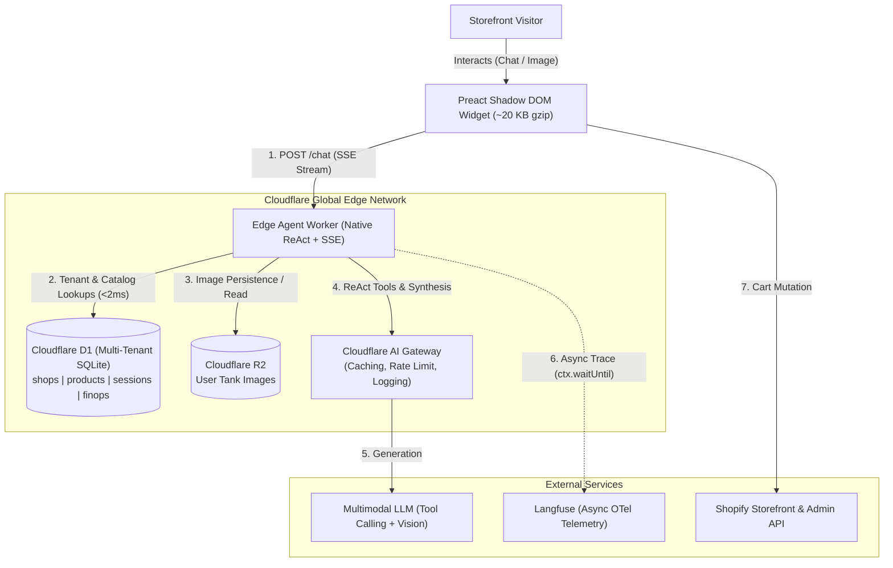

# AquaBot — Production Agentic AI & Edge Architecture Case Study

> **Note:** This repository is the public **architecture & engineering case study** for **AquaBot**, a commercial multi-tenant AI e-commerce sales & domain engineering assistant. Proprietary source code, prompts, catalog data, and deployment identifiers are kept in a private repository.

**AquaBot** is a multimodal, multi-tenant **agentic AI sales assistant** built for specialized e-commerce stores (aquascaping & aquarium hardware). Instead of wrapping a generic LLM in a chat box, AquaBot runs a **framework-less Native ReAct Agent Loop** directly on **Cloudflare V8 Edge Workers**, combining deterministic engineering calculations, real-time inventory grounding, and vision analysis with sub-2ms edge database lookups.

---

## Why This Architecture Matters (Key Engineering Highlights)

* **Framework-less Native ReAct on the Edge (`0ms` Cold-Start):** Orchestrates multi-turn `functionCall` $\rightarrow$ deterministic tool execution $\rightarrow$ `functionResponse` $\rightarrow$ streaming synthesis using pure Web Standards (`fetch`, `TransformStream`, `ReadableStream`) without LangChain/LlamaIndex bloat.
* **Zero-Hallucination Agentic Guardrails:** The agent never guesses prices, stock, or physical tank calculations. All numerical specs come from deterministic domain tools, and product recommendations are constrained by structured JSON schemas (`responseSchema`) against verified tenant inventory.
* **Transparent Agentic UX via SSE:** Streams ephemeral `status` events (e.g., *calculating specs*, *searching catalog*, *analyzing image*) over Server-Sent Events while keeping intermediate tool noise out of persistent conversation history.
* **3-Layer AI Agent Testing Pyramid:** Avoids the expensive "inverted eval pyramid" by separating `$0` deterministic unit/security checks, mocked scripted-trajectory + Vector Bypass tests, and live DeepEval (`ToolCorrectnessMetric`, `FaithfulnessMetric`, `G-Eval`) + adversarial red-teaming.
* **Drop-In Shadow DOM Widget (`~20 KB` gzip):** Embeds into Shopify (App Embed) and any custom storefront via two HTML lines with complete CSS isolation and `AbortController`-backed stream cancellation.

---

## System Architecture

---

## Documentation & Architecture Decision Records (ADRs)

| Document | Focus Area |
| :--- | :--- |
| [01 — Agentic Architecture & Streaming](docs/01-agentic-architecture.md) | 3-stage Native ReAct loop, `thoughtSignature` integrity, multimodal vision routing, resilient `ctx.waitUntil` persistence |
| [02 — AI Engineering & 3-Layer Evals](docs/02-ai-engineering-and-evals.md) | Zero-hallucination design, Vector Bypass vs. RAG, Scripted-Trajectory tests, DeepEval / G-Eval & red-teaming |
| [03 — Multi-Tenant Security & FinOps](docs/03-security-and-finops.md) | Tenant isolation (`shop_domain`), fail-closed HMAC webhooks, R2 CSP headers, zero-cost incremental ingestion |
| [ADR-001](docs/adr/ADR-001-fastapi-to-cloudflare-edge.md) | Why we migrated from Python/FastAPI to Cloudflare V8 Edge Workers |
| [ADR-002](docs/adr/ADR-002-frameworkless-native-react-agent.md) | Why we built a framework-less Native ReAct loop instead of using agent frameworks |
| [ADR-003](docs/adr/ADR-003-shadow-dom-preact-widget.md) | Why we chose Preact + Shadow DOM (`~20 KB` gzip) over an `<iframe>` |
| [ADR-004](docs/adr/ADR-004-three-layer-agent-testing-pyramid.md) | How we structured a 3-layer AI testing pyramid to control eval cost & flakiness |

---

## Embeddable Storefront Widget

The client layer is compiled as a standalone Preact 10 custom element (`<aquarium-ai-widget>`) encapsulated in a **Shadow DOM** boundary:
* **60fps Streaming Render:** Consumes `text/event-stream` via `fetch()` + `ReadableStream` with `requestAnimationFrame` batching.
* **Three Agentic Entry Modes:** Direct Dimension Calculation (deterministic engineering recipe), Photo-to-Setup (multimodal vision analysis), and Guided Consultation (low-friction discovery).
* **Cart & Handoff:** Mutates storefront carts directly or hands off a structured equipment list to WhatsApp.

---

## License & Notice

Documentation in this repository is licensed under the [MIT License](LICENSE).  
**AquaBot** source code, domain calculation coefficients, and production prompts are proprietary and maintained privately.
