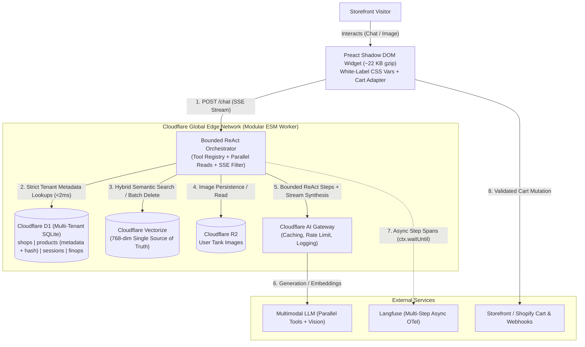

# AquaBot — Production Agentic AI & Edge Architecture Case Study

> **Note:** This repository is the public **architecture & engineering case study** for **AquaBot**, a commercial multi-tenant AI e-commerce sales & domain engineering assistant. Proprietary source code, prompts, catalog data, and deployment identifiers are kept in a private repository.

**AquaBot** is a multimodal, multi-tenant **agentic AI sales assistant** built for specialized e-commerce stores (aquascaping & aquarium hardware). Instead of wrapping a generic LLM in a chat box or chaining brittle multi-model prompts, AquaBot runs a **single-brain Bounded Native ReAct Agent Loop** directly on modular **Cloudflare V8 Edge Workers**, combining **parallel tool orchestration**, **Vectorize-backed Agentic RAG** with deterministic SQL Vector Bypass, engineering calculations, real-time inventory grounding, and vision analysis.

---

## Why This Architecture Matters (Key Engineering Highlights)

* **Single-Brain Bounded ReAct Loop (`0ms` Cold-Start):** Orchestrates multi-step reasoning through a generic **Read/Write Tool Registry** using pure Web Standards (`fetch`, `TransformStream`, `ReadableStream`). Read-only tool calls (e.g., multi-category catalog searches) execute concurrently via `Promise.all`, while state-mutating calls execute serially—guarded by a `(tool, normalizedArgs)` loop circuit breaker and dual step/budget ceilings with tool-free graceful wrap-up.
* **Vectorize Single Source of Truth + SQL Vector Bypass:** 768-dimensional embeddings reside exclusively in **Cloudflare Vectorize** (keeping only a 16-character content hash in D1), eliminating database bloat and enabling batch deletion (`20` IDs/batch) on stock-outs. Semantic queries leverage model-driven expansion (`search_terms`) fused via Reciprocal Rank Fusion (RRF), while deterministic sorting/price queries bypass embeddings (`embedCallCount == 0`).
* **Zero-Hallucination & Strict Multi-Tenant Guardrails:** Numerical domain specs come from deterministic engineering code, cart mutations are validated against live tenant SKUs, and stores with empty online catalogs strictly report zero availability without leaking a shared default catalog.
* **Streaming UX & `$0` Contextual Quick Replies:** Streams ephemeral `status` events during tool execution and extracts trailing `<quick_replies>` chips in the user's detected language via a sliding-tail SSE stream filter at zero extra LLM cost.
* **3-Layer AI Agent Testing Pyramid:** Separates `$0` deterministic unit/security/streaming checks, Layer 2 scripted-trajectory + Loop Detector + Vector Bypass + Playwright Shadow DOM E2E checks, and Layer 3 live edge DeepEval (`ContextualRelevancyMetric`, `FaithfulnessMetric`, `G-Eval`) + adversarial red-teaming.
* **Modular White-Label Shadow DOM Widget (`~22 KB` gzip):** Embeds via two HTML lines with full CSS isolation, dynamic `color-mix()` theming, domain-scoped session isolation, and a storefront-agnostic **Cart Adapter** that surfaces real storefront errors instead of faking cart success.

---

## System Architecture

---

## Documentation & Architecture Decision Records (ADRs)

| Document | Focus Area |
| :--- | :--- |
| [01 — Agentic Architecture & Streaming](docs/01-agentic-architecture.md) | Bounded single-brain ReAct loop, parallel read / serial write Tool Registry, loop detector, `thoughtSignature` integrity, sliding-tail `<quick_replies>` |
| [02 — Agentic RAG & Hybrid Retrieval](docs/02-agentic-rag-and-retrieval.md) | Model-driven `search_terms`, RRF hybrid retrieval, Vectorize Single Source of Truth, batch out-of-stock purge, SQL Vector Bypass |
| [03 — AI Engineering & 3-Layer Evals](docs/03-ai-engineering-and-evals.md) | Zero-hallucination guardrails, Loop/Vectorize/Playwright E2E tests, DeepEval / G-Eval & rate-limit-hardened eval judge |
| [04 — Multi-Tenant Security & FinOps](docs/04-security-and-finops.md) | Strict tenant isolation, cross-domain session boundaries, fail-closed HMAC webhooks, D1 storage slimming, SQL funnel revenue |
| [ADR-001](docs/adr/ADR-001-fastapi-to-cloudflare-edge.md) | Why we migrated from Python/FastAPI to Cloudflare V8 Edge Workers |
| [ADR-002](docs/adr/ADR-002-frameworkless-native-react-agent.md) | Framework-less Native ReAct loop instead of heavy agent frameworks *(Amended v2)* |
| [ADR-003](docs/adr/ADR-003-shadow-dom-preact-widget.md) | Why we chose Preact + Shadow DOM over an `<iframe>` *(with white-label theming & Cart Adapter)* |
| [ADR-004](docs/adr/ADR-004-three-layer-agent-testing-pyramid.md) | How we structured a 3-layer AI testing pyramid to control eval cost & flakiness |
| [ADR-005](docs/adr/ADR-005-hybrid-agentic-rag-with-sql-bypass.md) | Hybrid Agentic RAG + SQL Vector Bypass *(Amended v2)* |
| [ADR-006](docs/adr/ADR-006-single-brain-parallel-react-loop.md) | Moving from dual-LLM JSON selection to a single-brain parallel ReAct loop & Tool Registry |
| [ADR-007](docs/adr/ADR-007-vectorize-single-source-of-truth.md) | Eliminating D1 embedding bloat with Vectorize Single Source of Truth & strict tenant isolation |

---

## Embeddable Storefront Widget

The client layer is organized into modular Preact components and utilities, compiled into a custom element (`<aquarium-ai-widget>`) encapsulated in a **Shadow DOM** boundary:
* **60fps Streaming Render:** Consumes `text/event-stream` via `fetch()` + `ReadableStream` with `requestAnimationFrame` batching and `AbortController` reset cancellation.
* **White-Label Dynamic Theming:** Reads store branding (`primary_color`, `welcome_message`) at initialization and derives hover/soft tokens cleanly with CSS `color-mix()` custom properties.
* **Storefront-Agnostic Cart Adapter:** Prioritizes custom storefront hooks (`AquaCartAdapter` $\rightarrow$ cancelable `aqua:add_to_cart` event) before conditionally invoking Shopify AJAX cart endpoints—strictly displaying real stock/API errors instead of faking success.

---

## License & Notice

Documentation in this repository is licensed under the [MIT License](LICENSE).  
**AquaBot** source code, domain calculation coefficients, and production prompts are proprietary and maintained privately.
