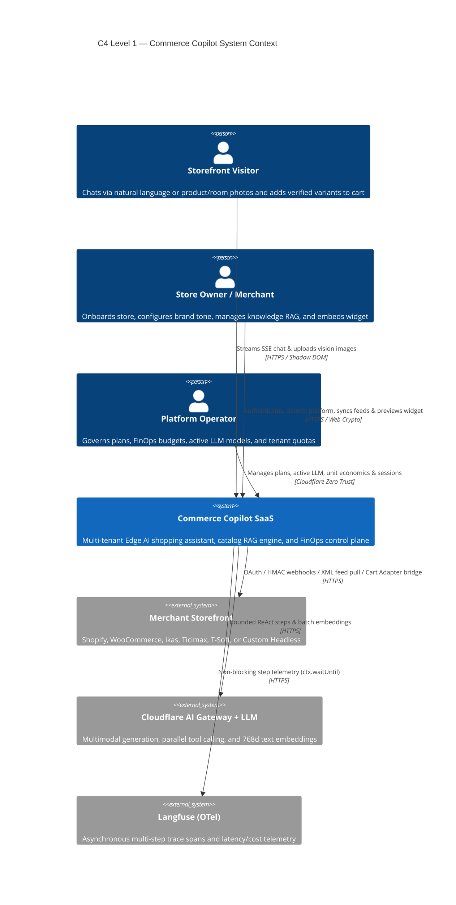
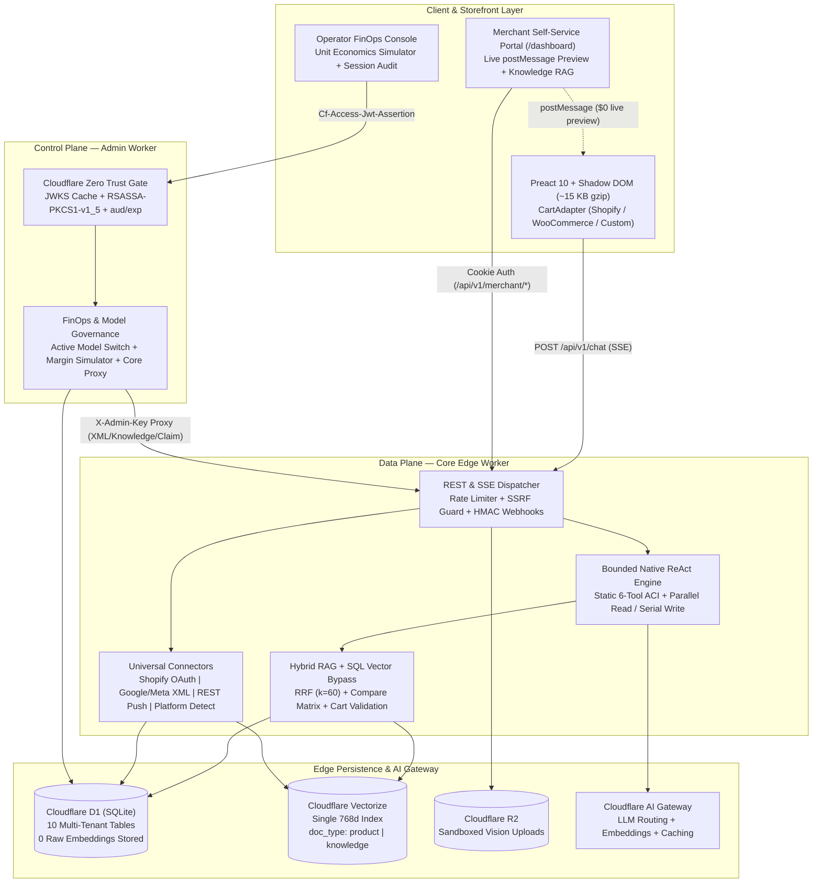
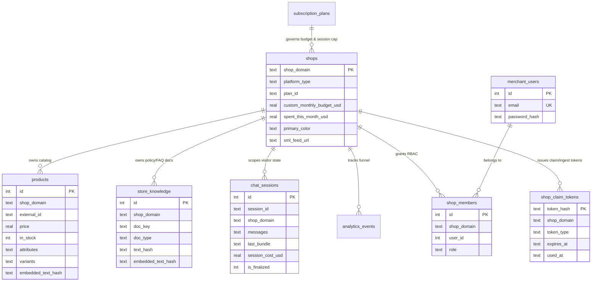

# 00 — C4 Architecture, Three-Plane Topology & Multi-Tenant Data Model

**Commerce Copilot** is a multi-tenant, domain-agnostic AI shopping assistant and SaaS FinOps platform built natively on **Cloudflare V8 Edge Workers**. The architecture separates storefront customer inference (**Data Plane**), tenant onboarding and live preview (**Tenant Self-Service Plane**), and platform unit-economics governance (**Control Plane**) over a strictly isolated **Cloudflare D1**, **Vectorize**, and **R2** storage foundation.

---

## 1. C4 Level 1 — System Context

---

## 2. C4 Level 2 — Three-Plane Container Topology

---

## 3. C4 Level 3 — Core Worker Component Boundaries

Inside the Core Worker, domain policy is strictly separated from orchestration, LLM transport, and persistence:

| Layer | Module Responsibility | Key Invariant |
| :--- | :--- | :--- |
| **HTTP & Security** | `core/auth.mjs`, `core/merchant_auth.mjs`, `core/ssrf.mjs`, `core/r2.mjs` | Fail-closed auth, PBKDF2-SHA256 (`100k`), HTTPS-only SSRF & redirect validation, `sandbox` CSP for R2 images |
| **Agent Orchestrator** | `agent/react_loop.mjs`, `agent/registry.mjs`, `agent/loop_detector.mjs` | Provider- and domain-agnostic loop; static tool declarations preserve KV-cache prefix |
| **LLM Abstraction** | `llm/provider.mjs`, `llm/providers/gemini.mjs`, `llm/langfuse.mjs` | Isolates wire format (`streamChat`, `chat`, `embedText`, `embedBatch`) and async OTel spans |
| **Domain Tooling** | `domain/commerce/tools.mjs`, `domain/commerce/prompts.mjs` | Exposes 6 static tools (or vertical extensions such as `calculate_aquarium_specs`) |
| **RAG & Cart** | `rag/search.mjs`, `rag/knowledge_search.mjs`, `rag/compare.mjs`, `cart/cart_mutation.mjs` | Dual-doc Vectorize queries, SQL Vector Bypass (`embedCallCount == 0`), fail-loud variant checks |
| **Connectors** | `connectors/shopify.mjs`, `connectors/xml_feed.mjs`, `connectors/rest_push.mjs`, `connectors/platform_detect.mjs` | Unified ingestion pipeline into `(shop_domain, external_id)` + incremental hash-based re-indexing |

---

## 4. Multi-Tenant D1 Schema (10 Tables)

All tenant data is partitioned by `shop_domain` with composite covering indexes on `(shop_domain, in_stock, price)` and `(shop_domain, category, in_stock)`. Raw 768-dimensional float vectors are **never** stored in D1; D1 holds only 16-character `text_hash` / `embedded_text_hash` fingerprints.

