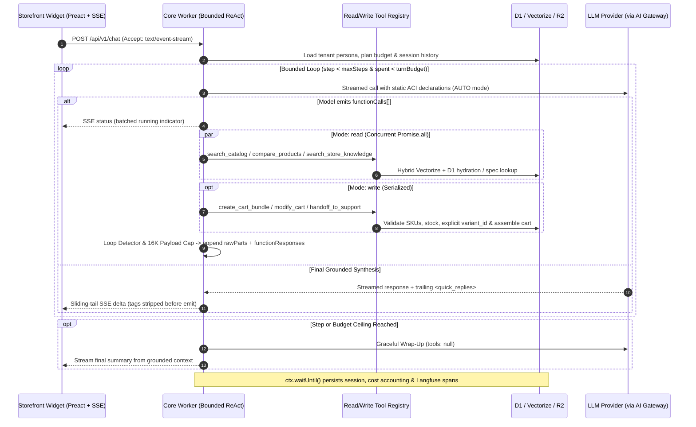

# 01 — Agentic Architecture, Static ACI & Streaming Orchestration

Commerce Copilot executes a **framework-less Bounded Native ReAct (Reasoning + Acting) Loop** directly inside Cloudflare V8 Edge Workers. Rather than chaining multiple disconnected LLM calls or relying on brittle regex intent routers, a single reasoning model drives a declarative **Read/Write Tool Registry** with parallel tool execution, fail-loud validation, and zero-flicker SSE synthesis.

> **Reference Implementations:** [`references/src/agent/registry_and_loop.mjs`](../references/src/agent/registry_and_loop.mjs), [`references/src/agent/loop_detector.mjs`](../references/src/agent/loop_detector.mjs), [`references/src/cart/cart_mutation.mjs`](../references/src/cart/cart_mutation.mjs), [`references/src/streaming/sse_filter.mjs`](../references/src/streaming/sse_filter.mjs)

---

## 1. Single-Brain Bounded ReAct Execution Flow

---

## 2. Static 6-Tool Universal ACI & KV-Cache Prefix Stability

The Agent-Computer Interface (ACI) exposes a compact, strictly typed set of 6 universal e-commerce tools defined via `parametersJsonSchema` (`additionalProperties: false`, explicit `required` and `enum` constraints). Domain-vertical deployments (such as AquaBot) register domain-specific deterministic calculation tools alongside the same orchestrator loop.

| Tool Name | Mode | Execution | Purpose & Schema Contract |
| :--- | :--- | :--- | :--- |
| `search_catalog` | `read` | Concurrent | Leading `intent` thought slot; `query`, `search_terms[]`, `category`, `brand`, `attribute_filters[]`, `min_price`, `max_price`, `sort_by`, `limit` |
| `compare_products` | `read` | Concurrent | Leading `intent` thought slot; side-by-side matrix over `product_ids` (`2..4`) and `comparison_aspects[]` |
| `search_store_knowledge` | `read` | Concurrent | Leading `intent` thought slot; `query` and `topic` (`all \| shipping \| refund \| warranty \| faq \| about`) |
| `create_cart_bundle` | `write` | Serialized | Assembles initial multi-item bundles (`routine_set`, `outfit_combo`, `starter_kit`, `custom_bundle`) with explicit variant checks |
| `modify_cart` | `write` | Serialized | Incremental cart operations (`add`, `remove`, `set_quantity`, `replace`, `clear`) with atomic `replace` swap |
| `handoff_to_support` | `write` | Serialized | Generates a structured WhatsApp / support escalation payload carrying active cart context |

### Key Architectural Guarantees

1. **KV-Cache Prefix Invariance (`AUTO` Mode):** Tool declarations remain 100% static across every ReAct step (only the final ceiling wrap-up passes `tools: null`). Avoiding mid-loop `toolConfig` or schema mutations preserves prompt-prefix KV caching and prevents historical schema drift.
2. **Schema-Level Thought Slots (`intent`):** Placing a required `intent` string first on read tools anchors the model's reasoning about the shopper's goal before it emits search terms or product IDs, reducing ambiguous tool arguments without adding extra LLM calls.
3. **Provider-Agnostic LLM Boundary (`llm/provider.mjs`):** `react_loop.mjs` depends strictly on `{ chat, streamChat, embedText, embedBatch }`, decoupling orchestration, loop detection, and FinOps cost calculation from vendor HTTP wire formats.
4. **Fail-Loud Self-Correcting Cart Boundaries:** Cart tools strictly validate explicit `variant_id` arguments against live variant stock. On mismatch or out-of-stock, `cart_mutation.mjs` **never** silently falls back to `variants[0]`; it rejects with `reason: "invalid_variant_id" | "variant_out_of_stock"` and returns `available_variants[]` so the ReAct loop self-corrects within the same turn.
5. **Loop Circuit Breaker & Payload Cap:** `loop_detector.mjs` canonicalizes keys (`stableStringify`) and trips on `(toolName, normalizedArgs)` beyond `maxRepeats = 2`, returning `loop_detected` guidance. Tool responses exceeding `16,000` characters are deterministically trimmed to protect context windows.

---

## 3. Multi-Turn Protocol Integrity & Zero-Cost Streaming UX

* **Verbatim `rawParts` & `thoughtSignature` Replay:** Reasoning tokens and opaque `thoughtSignature` metadata returned in model `functionCall` parts are preserved verbatim in working conversation history alongside 1-to-1 `functionResponse` entries.
* **Canonical `Read -> Write -> Synthesize` History Reconstruction:** Stored session turns containing prior cart bundles or product selections reconstruct canonical `search_catalog` → `create_cart_bundle` / `modify_cart` trajectories so follow-up turns (`"swap the shoes to size 43"`) retain grounded variant IDs.
* **Zero-Cost Multilingual `<quick_replies>` (`sse_filter.mjs`):** Instead of issuing a second LLM call for follow-up chips, the model appends `<quick_replies>[...]</quick_replies>` in the user's language. A stateful sliding-tail SSE stream filter buffers partial `<quick_` prefixes at chunk boundaries (while passing inline `<` math comparisons immediately) and emits clean chips in the `final` event.
* **Disconnect & Gateway Resilience (`ctx.waitUntil`):** Client aborts still flush session persistence, FinOps cost updates, and multi-step `edge_gemini_step_N` OpenTelemetry spans to Langfuse asynchronously. Transient upstream gateway errors never fabricate synthetic cart items or finalize/lock the user's session.
