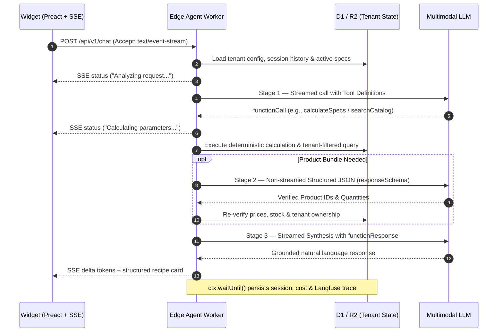

# 01 — Agentic Architecture & Streaming Orchestration

AquaBot is designed around a **framework-less Native ReAct (Reasoning + Acting) Agent Loop** executing at the network edge. Rather than treating the LLM as a monolithic text generator, the orchestrator splits each turn into deterministic and generative stages with strict protocol boundaries.

---

## 1. Three-Stage Native ReAct Execution Flow

When a user sends a message (or uploads an aquarium photo), the Edge Worker runs a 3-stage pipeline:

### Why 3 Stages?
1. **Stage 1 (Tool Decision, Streamed):** Allows immediate conversational replies when no tool is needed, or fast `functionCall` emission when domain calculation, catalog lookup, or cart mutation is required.
2. **Stage 2 (Structured Selection, Non-Streamed):** Uses `responseSchema` to force strict JSON output when assembling product bundles. Keeping this stage non-streamed prevents partial JSON leaks to the UI and enables deterministic backend verification before the user sees any price.
3. **Stage 3 (Grounded Synthesis, Streamed):** Receives verified `functionResponse` payloads so the final streamed explanation matches the exact numbers and SKUs in the interactive recipe card.

---

## 2. Multi-Turn Protocol Integrity (`thoughtSignature`)

Modern reasoning models emit internal reasoning signatures (`thoughtSignature`) alongside `functionCall` parts. Stripping or rewriting these parts across turns degrades tool-use reliability.

* AquaBot preserves raw model turn parts (`rawParts`) in session state so multi-turn tool trajectories remain cryptographically and structurally intact.
* Ephemeral UI `status` events emitted during tool execution are **never** written to persistent `chat_sessions` history, preventing context pollution.

---

## 3. Multimodal & Multi-Intent Agent Routing

The agent dynamically adapts its trajectory based on user intent:

| Mode | Trigger | Agentic Behavior |
| :--- | :--- | :--- |
| **Engineering Recipe** | Explicit tank dimensions | Runs deterministic physics/biology toolset $\rightarrow$ assembles verified equipment bundle |
| **Visual Scape Analysis** | Uploaded tank photo | Persists image to R2 $\rightarrow$ analyzes aquascape style, estimated volume & hardscape via Vision (up to last 3 images in context) $\rightarrow$ maps to catalog |
| **Guided Consultation** | Open-ended inspiration query | Asks targeted clarifying questions without prematurely dumping technical specs or unrequested products |
| **Cart Mutation** | Add/remove/update intent | Mutates active session basket via tool call and synchronizes with storefront cart endpoints |

---

## 4. Disconnect-Resilient Persistence

In streaming applications, users frequently close the browser tab or abort a request mid-stream. Using Cloudflare's `ctx.waitUntil()`, AquaBot guarantees that:
* Partial or completed session state is saved to D1.
* Token usage and session cost (`session_cost_usd`) are recorded accurately.
* Asynchronous OpenTelemetry traces are flushed to Langfuse without adding latency to the user's first token.
