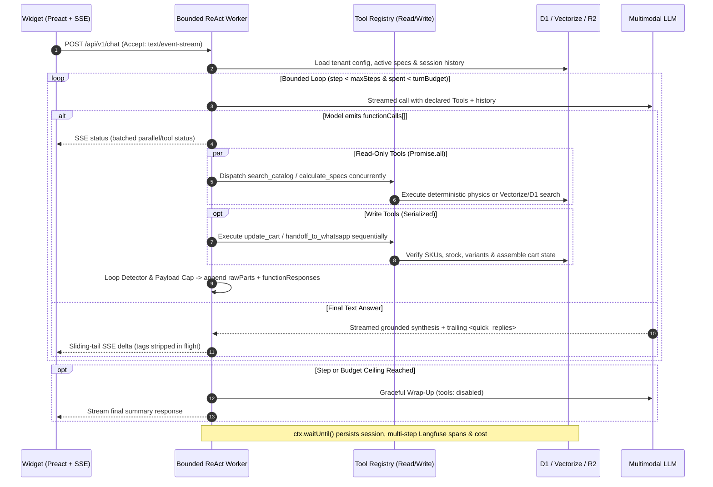

# 01 — Agentic Architecture & Streaming Orchestration

AquaBot runs a **modular, framework-less Bounded Native ReAct (Reasoning + Acting) Agent Loop** at the Cloudflare edge. Rather than chaining disconnected LLM calls with hidden intermediate JSON selectors, a single reasoning model drives a declarative **Tool Registry** with strict loop safety, parallel read execution, and single-point streaming synthesis.

---

## 1. Single-Brain Bounded Native ReAct Flow

When a user sends a message (or uploads an aquarium photo), the Edge Worker invokes the generic Bounded ReAct Orchestrator backed by the domain's declarative Read/Write Tool Registry:

### Key Architectural Properties
1. **Single-Brain Grounded Context:** Retiring the legacy secondary JSON-selection LLM eliminated double inference latency, context split-brain errors, and category mismatches. The same model that inspects user photos and reasons over calculations also inspects retrieved SKUs and invokes verified cart mutations directly.
2. **Parallel Read / Serialized Write Dispatch:** When a turn requires multiple independent catalog lookups (e.g., substrate + canister filter + heater + lighting), the model emits parallel `functionCall` parts in a single turn. The Tool Registry runs `mode: "read"` tools concurrently via `Promise.all` and `mode: "write"` tools strictly sequentially to preserve cart consistency. Round-robin merging ensures single-product suggestion shelves represent every queried category evenly.
3. **Bounded Execution & Loop Circuit Breaker:**
   * Enforces dual ceilings: `maxSteps = 8` and a per-turn FinOps spend cap.
   * Tracks `(toolName, stableStringify(args))` signatures per turn; repeating an identical signature beyond threshold (`> 2`) injects a `loop_detected` feedback payload instead of failing or looping endlessly.
   * If a ceiling is reached without a final answer, the loop performs a tool-free (`tools: disabled`) synthesis pass so the user still receives a coherent response.
4. **Zero-Extra-Cost Contextual `<quick_replies>`:** Instead of serving static Turkish buttons or paying for a second LLM call to generate follow-up chips, the agent appends `<quick_replies>[...]</quick_replies>` at the end of its synthesis in the user's exact conversation language. A stateful sliding-tail SSE stream filter withholds potential partial tags at chunk boundaries so raw XML/JSON tags never flicker in the UI, then delivers the parsed array in the `final` event.

---

## 2. Multi-Turn Protocol Integrity (`thoughtSignature` & Legacy Normalization)

Modern reasoning models attach encrypted/opaque `thoughtSignature` tokens inside `functionCall` response parts.
* **Verbatim `rawParts` Replay:** During a multi-step turn, the Edge Worker appends `res.rawParts` verbatim alongside 1-to-1 `functionResponse` entries so tool-use stability and reasoning alignment never degrade.
* **History Reconstruction:** Persisted conversation turns containing prior bundles or single-product recommendations are reconstructed into canonical `functionCall` $\rightarrow$ `functionResponse` $\rightarrow$ `model text` sequences (with automatic normalization of legacy tool identifiers into current active declarations), keeping exact product and variant IDs in reach for follow-up cart edits.
* Ephemeral UI `status` events remain strictly transient and are never persisted into `chat_sessions`.

---

## 3. Resilient Error & Quota Handling

* **Clean Transient Fallbacks:** If the upstream LLM gateway fails transiently, the Worker **never** fabricates synthetic equipment lists or locks the session (`is_finalized`). Instead, it preserves existing session state and offers a direct support card.
* **Quota-Locked Sessions:** Once a session genuinely crosses its configured FinOps budget, subsequent messages execute at `$0.00` LLM cost—returning any existing verified bundle or a clean expert handoff card.
* **Disconnect Resilience (`ctx.waitUntil`):** Aborting or closing the browser mid-stream still finalizes session state persistence, token cost accounting, and multi-step `edge_gemini_step_N` OpenTelemetry spans to Langfuse asynchronously.
