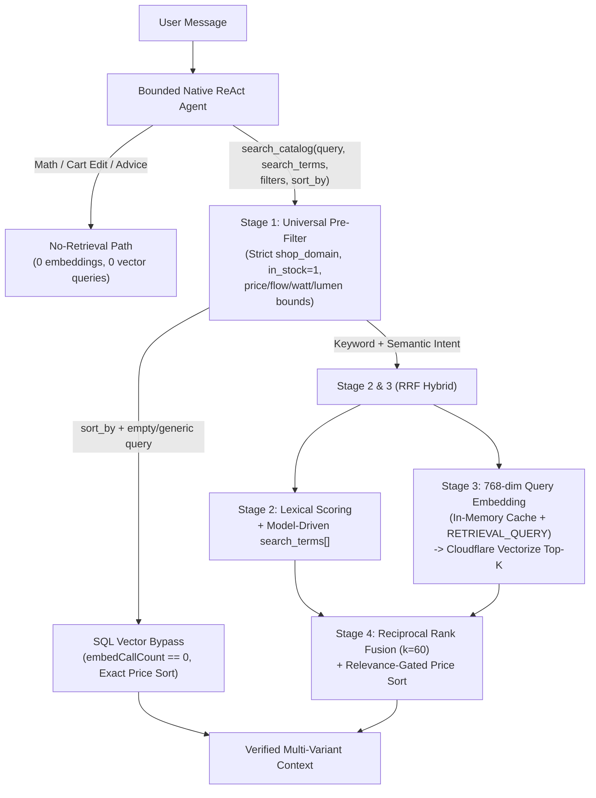

# 02 — Agentic RAG & Hybrid Retrieval Architecture

Traditional RAG pipelines run an embedding lookup on every user message, wasting latency and cost on queries that need **no retrieval** or suffer from semantic drift on **exact numeric queries** (e.g., *"cheapest canister filter"*). AquaBot implements **Hybrid Agentic RAG** backed by **Cloudflare Vectorize as the Single Source of Truth**.

---

## 1. Autonomous Retrieval & Hybrid Scoring Pipeline

### Key Retrieval Decisions
1. **Model-Driven Semantic Expansion (`search_terms`):** Rather than maintaining fragile hardcoded keyword synonym dictionaries in application code, the LLM passes contextual, cross-lingual `search_terms: string[]` directly into `search_catalog`. These expand both lexical recall and the semantic query string passed to embeddings.
2. **Vectorize Single Source of Truth (Zero D1 Embedding Bloat):**
   * 768-dimensional product vectors are stored **exclusively inside Cloudflare Vectorize** with metadata indexes (`shop_domain`, `in_stock`).
   * **Cloudflare D1** stores only lightweight product metadata and a 16-character content fingerprint (`embedded_text_hash`), hydrated with explicit column projection (excluding heavy raw ingestion payloads during chat turns).
3. **Deterministic Pre-Filtering & Vector Bypass (`embedCallCount == 0`):**
   * Price bounds (`min_price`, `max_price`), technical capacities, and `in_stock = 1` are enforced deterministically *before* semantic fusion, ensuring out-of-budget or out-of-stock Vectorize candidates are automatically filtered out.
   * Global cheapest/most-expensive queries (`sort_by: price_asc | price_desc` with empty/wildcard query) bypass embedding generation completely and sort directly in memory over pre-filtered D1 inventory.
   * Self-healing category relaxation prevents empty results when the agent picks an overly narrow category slug while matching items exist in another category for the same tenant.

---

## 2. Real-Time Lifecycle Sync, Batch Pruning & Background Enrichment

* **Stock & Deletion Pruning:** When a catalog sync or Shopify webhook transitions a SKU from `in_stock: 1 -> 0` or deletes a product, vectors are purged from Vectorize in chunked batches (`deleteVectorsInBatches`, 20 IDs per call) and `embedded_text_hash` is cleared in D1 so stale vectors never accumulate.
* **Return-to-Stock & Incremental Re-Indexing:** Transitioning `0 -> 1` or changing semantic product fields automatically regenerates and upserts the Vectorize vector; price-only or inventory-count updates preserve `embedded_text_hash` at `$0` embedding cost.
* **Automatic Background Enrichment (`ctx.waitUntil`):** Newly synced or webhook-created in-stock products missing extracted technical metadata (`needsEnrichment == true`) trigger bounded background LLM spec enrichment automatically without blocking webhook/API responses.
