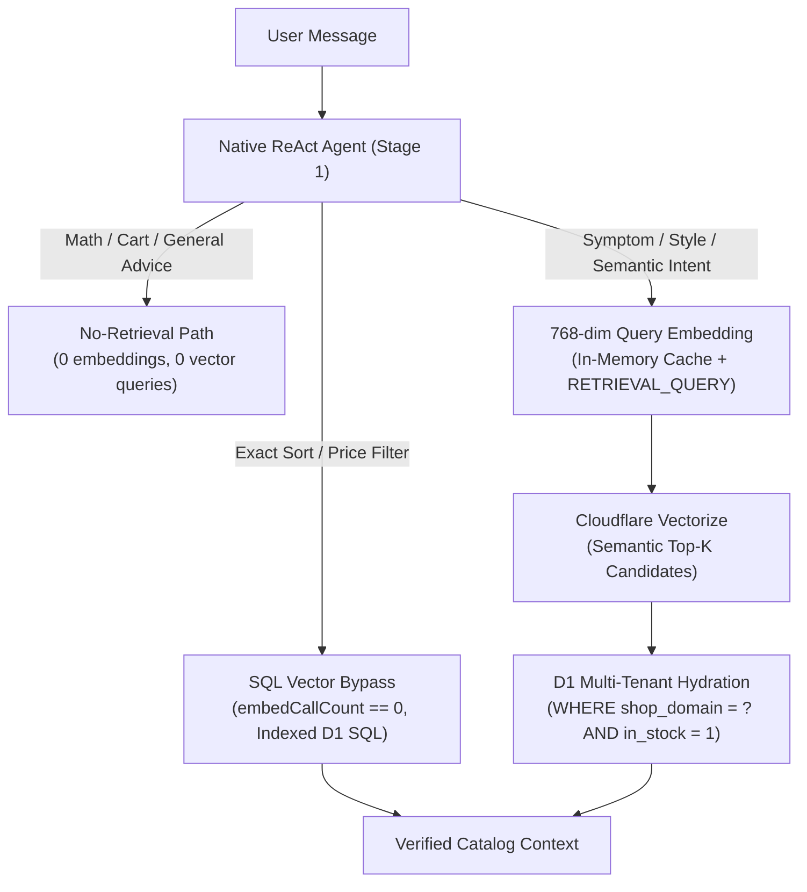

# 02 — Agentic RAG & Hybrid Retrieval Architecture

Traditional RAG pipelines run an embedding lookup on every user message, wasting latency and cost on queries that either need **no retrieval** (e.g., math calculations, cart updates) or are better answered by **exact SQL filtering** (e.g., *"cheapest external filter"*). AquaBot implements **Agentic RAG**—the ReAct agent autonomously selects the optimal retrieval path per turn.

---

## 1. Autonomous Retrieval Decision Tree

### The Three Execution Paths
1. **No-Retrieval Path (`0` Embedding Cost):** Pure engineering calculations, cart mutations, or open-ended consultation skip vector search entirely.
2. **SQL Vector Bypass (`embedCallCount == 0`):** When the agent detects deterministic sorting or numeric constraints (e.g., `sort_by: price_asc`, budget caps), it bypasses Vectorize and queries indexed Cloudflare D1 SQL directly—preventing semantic drift from returning expensive items when the user asked for the cheapest one.
3. **Semantic Vectorize Path:** For natural-language problem solving (e.g., *"green water algae treatment"* or *"low-light foreground plants"*), the worker generates a 768-dimensional embedding and queries **Cloudflare Vectorize**, then hydrates matched product IDs from D1 to enforce live stock and tenant boundaries.

---

## 2. Asymmetric Embeddings & Edge Caching

* **Asymmetric Task Types:** Catalog items are indexed using `RETRIEVAL_DOCUMENT` embeddings during ingestion, while live user queries use `RETRIEVAL_QUERY` embeddings (`768` dimensions).
* **In-Memory Query Cache:** Repeated query embeddings within the worker isolate are served from an in-memory cache (`_queryEmbeddingCache`), eliminating redundant embedding API round-trips on common storefront questions.

---

## 3. Multi-Tenant Hydration & Zero-Cost Ingestion

* **Post-Vector Verification:** Vectorize returns candidate IDs, but **Cloudflare D1 is always the source of truth** for `shop_domain` isolation, `in_stock = 1` availability, and current pricing.
* **Zero-Cost Incremental Ingestion:** During catalog syncs, product text is hashed. Unchanged products incur `$0` LLM enrichment and `$0` re-embedding cost; only modified or newly added SKUs trigger Vectorize upserts.
