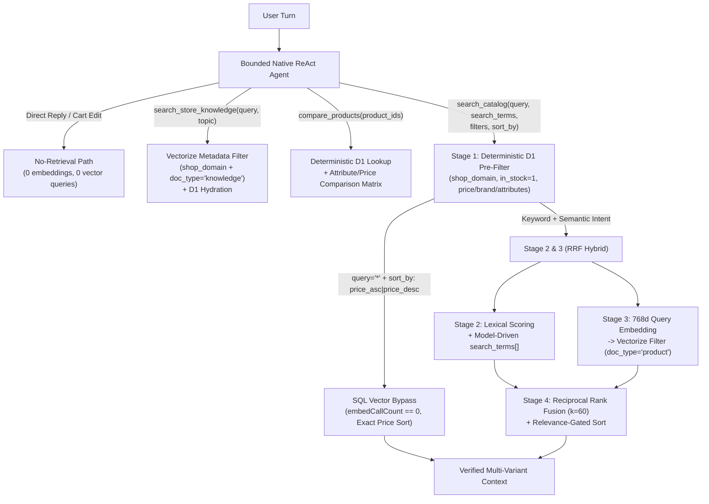

# 02 — Agentic Hybrid RAG, Dual-Doc Vectorize & SQL Bypass

Traditional RAG architectures vector-search every incoming user message, wasting latency and embedding budget on queries that require **exact price ordering**, **store policy retrieval**, or **structured multi-product comparison**. Commerce Copilot implements **Hybrid Agentic RAG** backed by a single **Cloudflare Vectorize** index (`768d`, cosine) as the Single Source of Truth (SSOT).

---

## 1. Dual-Document Vectorize Contract & Retrieval Pipeline

A single Vectorize index stores both **product catalog vectors** and **store knowledge/policy vectors**, partitioned strictly by `shop_domain` and `doc_type`:

* **Product Vector (`prod:<shopHash>:<extHash>`):** Metadata carries `{ shop_domain, doc_type: "product", in_stock, price, category, brand }`.
* **Knowledge Vector (`know:<shopHash>:<docKeyHash>`):** Metadata carries `{ shop_domain, doc_type: "knowledge", knowledge_type, doc_key }` (`shipping`, `refund`, `warranty`, `faq`, `about`, `policy`).

---

## 2. Core Retrieval & Storage Engineering Decisions

1. **Zero Embedding Bloat in D1 (~88% Footprint Reduction):**
   * 768-dimensional float arrays live **exclusively** in Cloudflare Vectorize.
   * D1 retains only lightweight metadata and a 16-character content fingerprint (`text_hash` and `embedded_text_hash`). Chat hydration uses explicit column `SELECT` projection, excluding heavy `raw_payload` ingestion blobs.
2. **SQL Vector Bypass (`embedCallCount == 0`):**
   * Exact inventory browsing and global sorting queries (`query: "*"` or empty query paired with `sort_by: "price_asc" | "price_desc"`) bypass embedding API calls entirely and execute deterministic SQL filtering + in-memory sorting over verified D1 inventory.
3. **Model-Driven Semantic Expansion (`search_terms[]`):**
   * Rather than maintaining brittle hardcoded synonym tables per vertical, the reasoning model passes cross-lingual `search_terms[]` into `search_catalog`, boosting both lexical recall and embedding query richness before Reciprocal Rank Fusion (`k = 60`).
4. **Deterministic Product Comparison (`compare_products`):**
   * `rag/compare.mjs` hydrates `2..4` SKUs from D1 and builds a structured, zero-hallucination comparison matrix across normalized `attributes` JSON keys, base/variant pricing, brand, and stock status.
5. **Hash-Based Incremental Sync & Batch Vector Pruning:**
   * Catalog syncs and webhooks compute a semantic hash per product/knowledge document. Price-only or inventory-count updates preserve `embedded_text_hash` at `$0` embedding cost.
   * When products go out of stock (`in_stock: 1 -> 0`) or are deleted, vectors are purged in batches of `20` IDs (`deleteVectorsInBatches`) and `embedded_text_hash` is cleared so stale items never surface in semantic Top-K results.
6. **Strict Tenant Isolation & Category Relaxation:**
   * Every query enforces `shop_domain = ?` in D1 and `{ shop_domain }` metadata filtering in Vectorize. Custom stores with empty catalogs return `catalog_empty` transparently rather than leaking shared demo products. If a narrow `category` filter returns zero hits while matching items exist under another category for the same store, bounded category relaxation prevents false negatives.
