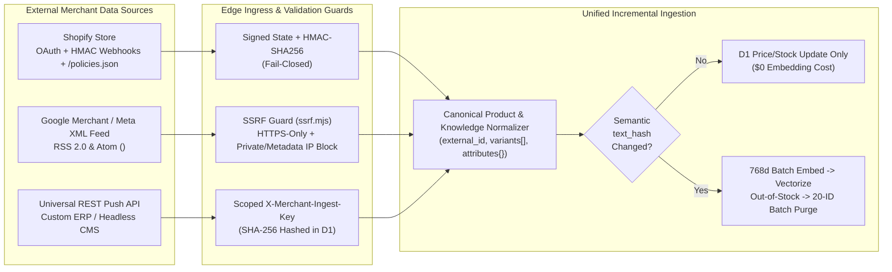

# 03 — Universal Catalog Connectors, Platform Discovery & SSRF Boundary

To serve heterogeneous e-commerce merchants without forcing manual data migrations, Commerce Copilot normalizes catalogs from **three universal ingestion connectors** into a unified `(shop_domain, external_id)` schema with dynamic `attributes` JSON and multi-variant support—protected at every external network boundary by an **SSRF guard**.

> **Reference Implementations:** [`references/src/core/ssrf.mjs`](../references/src/core/ssrf.mjs), [`references/src/connectors/platform_detect.mjs`](../references/src/connectors/platform_detect.mjs)

---

## 1. Three Universal Ingestion Connectors

### 1.1 Shopify Native Connector
* **OAuth & Token Lifecycle:** `/api/v1/shopify/auth` → `/callback` validates signed `state` parameters, exchanges authorization codes, and supports `refresh_token` rotation.
* **Fail-Closed Webhooks:** `products/create`, `products/update`, `products/delete`, `app/uninstalled`, and GDPR compliance webhooks verify `X-Shopify-Hmac-Sha256` against the app secret before parsing or mutating state.
* **Automatic Policy RAG:** Syncs `/policies.json` directly into `store_knowledge` and Vectorize (`doc_type: "knowledge"`) so the assistant answers shipping and refund questions immediately after installation.

### 1.2 Google Merchant / Meta Catalog XML Feed Connector
* **Multi-Format Parser:** Streaming-safe parser supporting both **RSS 2.0** (`<item>`) and **Atom** (`<entry>`) feeds, CDATA decoding, and locale-aware currency parsing (`TRY`/`TL`, `USD`, `EUR`, `GBP` with European vs. US decimal separator disambiguation).
* **Variant Grouping (`<g:item_group_id>`):** Consolidates flat variant feed items sharing `<g:item_group_id>` into a single canonical parent product with populated `variants[]` (color, size, price, availability), preventing duplicate clutter in RAG search results.

### 1.3 Universal REST Push API (`POST /api/v1/catalog/ingest`)
* **Scoped Tenant Keys:** Accepts either platform `X-Admin-Key` or a shop-scoped `X-Merchant-Ingest-Key` (validated via SHA-256 digest lookup against `shop_claim_tokens` bound strictly to the target `shop_domain`).
* Supports batch product upserts, explicit SKU deletions with Vectorize cleanup, and `store_knowledge` URL/text document ingestion.

---

## 2. SSRF Boundary (`ssrf.mjs`)

Any server-side fetch triggered by a merchant (XML feed sync, storefront platform detection, or knowledge URL ingestion) passes through `validateExternalFeedUrl` and `safeFetchRemoteText`:

| Attack Vector | Defense Enforced |
| :--- | :--- |
| **Non-HTTPS Protocols** | Strictly rejects `http://`, `ftp://`, `file://`, `gopher://`, and URLs containing embedded `user:pass@` credentials |
| **Loopback & Private Networks** | Blocks `127.0.0.0/8`, `10.0.0.0/8`, `172.16.0.0/12`, `192.168.0.0/16`, `100.64.0.0/10` (CGNAT), `0.0.0.0`, and multicast/reserved ranges |
| **Cloud Metadata & Internal DNS** | Explicitly blocks `169.254.169.254`, `metadata.google.internal`, `metadata.goog`, `.local`, `.internal`, `.localhost` |
| **IPv6 & Obfuscated IP Bypass** | Blocks `::`, `::1`, link-local `fe80:`, ULA `fc`/`fd`, IPv4-mapped IPv6 (`::ffff:127.0.0.1` and WHATWG hex-normalized `::ffff:7f00:1`), numeric IPs (`2130706433`), and hex IPs (`0x7f000001`) |
| **Open Redirect Bypass** | Executes `fetch(..., { redirect: "manual" })` and re-validates every `3xx` `Location` header through `validateExternalFeedUrl` (capped at `maxRedirects = 3`) |
| **Memory Exhaustion** | Enforces `AbortController` timeouts (`8000ms`) and strict `Content-Length` + buffer byte ceilings (`2 MB` for feeds, `512 KB` for detection) |

---

## 3. Wappalyzer-Style Storefront Platform & Feed Auto-Discovery

During onboarding, `detectStorefrontPlatform` fetches the merchant's storefront safely via `safeFetchRemoteText` and scores signals across **HTTP headers**, **HTML `<meta>` / global JS hydration variables**, and **CDN/asset paths** (`confidence` up to `0.99`):

* Detects **Shopify** (`shopify_ajax`), **WooCommerce** (`woocommerce_ajax`), **ikas**, **Ticimax**, **T-Soft**, or **Custom / Headless** (`custom_event`).
* Automatically extracts `<link rel="alternate" type="application/rss+xml|atom+xml">` feed URLs from HTML and parses `Sitemap:` directives from `/robots.txt` (`3.5s` timeout), pre-filling connector setup in the Merchant Portal.
