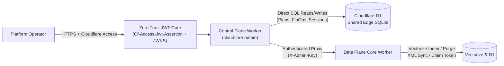

# 04 — Zero Trust Control Plane & FinOps Unit Economics Engine

Separating **Data Plane** inference from **Control Plane** governance ensures that billing, model routing, quota enforcement, and operator diagnostics scale independently without exposing administrative surfaces on public storefront routes. Both Commerce Copilot and AquaBot share this isolated **Control Plane Worker** (`cloudflare-admin`).

> **Reference Implementation:** [`references/src/core/webcrypto_auth.mjs`](../references/src/core/webcrypto_auth.mjs) (`verifyZeroTrustJwt`)

---

## 1. Control Plane vs. Data Plane Architecture

### Key Security Controls
* **Cloudflare Zero Trust JWT Verification:** Every request to the Control Plane validates `Cf-Access-Jwt-Assertion` using Web Crypto `RSASSA-PKCS1-v1_5` against the team's cached JWKS endpoint (`/cdn-cgi/access/certs`, 1-hour TTL). Verification fails closed if `ZERO_TRUST_AUD` or token `exp`/`aud` claims are missing or mismatched.
* **Service-to-Service Proxy (`proxyToCoreWorker`):** Actions requiring Vectorize indexing or cryptographic token issuance (XML feed sync, store knowledge ingestion/deletion, `claim_token` generation) are proxied securely from the Control Plane to the Core Worker over server-side `X-Admin-Key` credentials rather than duplicating Vectorize bindings in the admin worker.
* **Explicit Aggregate Projections (No N+1):** Shop overviews compute product counts, session counts, and spend totals in single SQL `LEFT JOIN ... GROUP BY` queries.

---

## 2. FinOps & Unit Economics Engine

Running multimodal ReAct agents across multi-tenant storefronts requires strict real-time cost visibility and hard spend ceilings:

1. **Dynamic Active Model Switching (`/api/finops/active-model`):** Operators manage a catalog of LLM models (`input_cost_per_1m`, `output_cost_per_1m`) in `finops_settings` and switch the live production model across all tenants without redeploying the Core Worker.
2. **Real-Time Per-Turn & Monthly Budget Guardrails:**
   * Each `subscription_plans` tier defines `monthly_price_usd`, `annual_price_usd`, `monthly_budget_usd`, and `session_limit_usd` (overridable per shop via `custom_monthly_budget_usd`).
   * The ReAct orchestrator tracks cumulative token spend inside each turn and exits into a tool-free wrap-up if a turn approaches its budget ceiling.
   * Sessions exceeding `session_limit_usd` are marked `is_finalized = 1`; subsequent messages return cached verified bundles or a support handoff card at `$0.00` LLM cost.
3. **Interactive Unit Economics Simulator (`/api/finops/calculate`):**
   * Combines the active model's token pricing, configurable operational `cost_drivers` (payment gateway `%` fees, per-session Edge/D1/Vectorize infra costs), and real SQL telemetry (`AVG(session_cost_usd)` from live sessions).
   * Calculates **cost per conversation** across scenario profiles, break-even session volume, and **gross margin %** per subscription tier before launching pricing changes.
4. **Session Audit & Recovery (`/api/sessions/:id` & `/unfinalize`):**
   * Operators inspect full multi-turn trajectories, active context, and `last_bundle` payloads alongside exact `session_cost_usd` accounting, with audited `unfinalize` controls for support resets.
