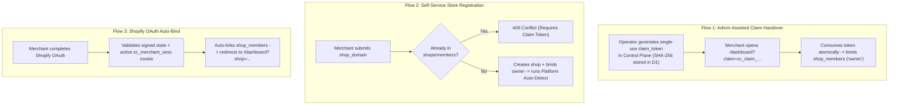

# 05 — Merchant Self-Service Portal, Web Crypto Auth & Storefront Widget

Commerce Copilot provides a zero-dependency **Tenant Self-Service Plane** (`/dashboard`) where merchants register or claim pre-provisioned stores, run automated platform/feed discovery, manage Vectorize knowledge documents, and preview their customized Shadow DOM widget live at `$0` LLM cost.

> **Reference Implementations:** [`references/src/core/webcrypto_auth.mjs`](../references/src/core/webcrypto_auth.mjs), [`references/src/connectors/platform_detect.mjs`](../references/src/connectors/platform_detect.mjs)

---

## 1. Zero-Dependency Edge Auth & Decoupled Store Ownership

Instead of introducing external identity providers (per-MAU SaaS billing and external network hops), authentication executes natively inside Cloudflare Workers via the **Web Crypto API**:

* **Password Hashing (`PBKDF2-SHA256`):** `100,000` iterations over a 16-byte cryptographic random salt (`pbkdf2_sha256$100000$<salt>$<hash>`), verified with constant-time byte comparison (`timingSafeEqualStr`).
* **Stateless Signed Session Cookie (`cc_merchant_sess`):** HMAC-SHA256 signed Base64URL payload (`uid`, `email`, `name`, `iat`, `exp`) delivered with `HttpOnly; Secure; SameSite=Lax`.
* **Identity vs. Store Decoupling (`merchant_users` ↔ `shop_members` ↔ `shops`):** Separating user identity from store records enables multi-store agency dashboards, role-based access (`owner`, `admin`, `editor`), and privilege-escalation prevention (`PUT /api/v1/merchant/shops/:domain/settings` strictly whitelists branding/persona fields and cannot mutate `plan_id` or `monthly_budget_usd`).

### Three Merchant Onboarding Flows

---

## 2. Live `$0`-Cost Widget Preview (`postMessage`) & Portal Tabs

Rather than maintaining a duplicate mock chat UI inside `/dashboard`, the portal embeds the production `<commerce-copilot-widget data-preview="true">` custom element in sandboxed preview mode:
* Changing `primary_color`, `store_name`, `welcome_message`, or `quick_replies` in the portal form dispatches a same-origin `postMessage` (`cc-dashboard:preview_config`) directly into the widget's Shadow Root—updating CSS `color-mix()` tokens and copy in `0ms` with zero API calls.
* Merchants can also trigger SSRF-guarded XML feed syncs, manage `store_knowledge` Vectorize RAG entries (with live `vector_indexed` status indicators), generate scoped `X-Merchant-Ingest-Key` credentials, and copy their single-line storefront embed snippet.

---

## 3. Embeddable Preact Shadow DOM Widget (`~15 KB` gzip)

* **CSS Isolation & Dynamic Theming:** Compiled as a standalone IIFE Custom Element (`<commerce-copilot-widget>`) with an encapsulated **Shadow DOM** boundary. Reads store branding at initialization and derives surface/hover/badge palettes using native CSS `color-mix()`.
* **60fps Streaming UX:** Consumes `text/event-stream` via `fetch()` + `ReadableStream`, throttles DOM updates via `requestAnimationFrame`, isolates session keys in domain-scoped `localStorage`, and cancels inflight streams cleanly via `AbortController` on conversation reset.
* **Storefront-Agnostic `CartAdapter`:** Automatically detects host cart bridges—invoking custom `window.CommerceCartAdapter` / cancelable DOM events first, then Shopify AJAX (`/cart/add.js`), or WooCommerce AJAX (`?wc-ajax=add_to_cart`)—strictly surfacing real `422`/`5xx` inventory errors instead of faking cart success.
